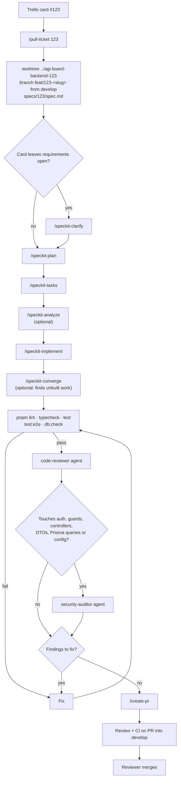

# agi-board-backend

REST API for AGI Board: NestJS 11 and Prisma 7 on Cloudflare Workers, with D1 (SQLite) as the database and R2
for images. Node.js 24 for tooling.

## Run locally

Requirements: Node.js 24 (`nvm use`), pnpm via Corepack (`corepack enable pnpm`). No Docker or Cloudflare
account needed: `wrangler dev` runs the Worker, D1 and R2 locally (state in `.wrangler/`).

```bash
pnpm install          # also runs `prisma generate`
pnpm db:seed          # label colors, board backgrounds (safe to re-run)
pnpm start:dev        # applies migrations, then http://localhost:8787/api/v1/health
```

| URL                                               | What                                          |
| ------------------------------------------------- | --------------------------------------------- |
| http://localhost:8787/api/v1/health, `/health/db` | Liveness, database check                      |
| http://localhost:8787/api/docs-json               | OpenAPI JSON (not in production; no UI)       |
| http://localhost:8025                             | Mailpit (`pnpm mail:up`): emails from the API |

Local variables: `wrangler.jsonc` `vars`, overridden by `.dev.vars` or `.env` (see `.env.example`).

## Scripts

| Script                                                        | Does                                                                                                      |
| ------------------------------------------------------------- | --------------------------------------------------------------------------------------------------------- |
| `pnpm lint`, `pnpm lint:fix`, `pnpm format`, `pnpm typecheck` | Code quality                                                                                              |
| `pnpm test`                                                   | Unit tests (`src/**/*.spec.ts`)                                                                           |
| `pnpm test:e2e`                                               | e2e tests against a local D1 in `.wrangler/e2e` (migrated automatically)                                  |
| `pnpm db:migrate`                                             | Apply migrations to the local D1                                                                          |
| `pnpm db:migrate:new <name>`                                  | Create an empty `prisma/migrations/NNNN_<name>.sql`                                                       |
| `pnpm db:diff`                                                | Print the SQL from the migrations to `prisma/schema`                                                      |
| `pnpm db:check`                                               | Fails if `prisma/schema` has changes with no migration                                                    |
| `pnpm db:seed`                                                | Seed system catalogs into the local D1, upload preset backgrounds (`assets/backgrounds/`) to the local R2 |
| `pnpm db:reset`                                               | Delete the local D1, re-migrate, seed                                                                     |

## Database workflow

The Prisma models in `prisma/schema/` are the source of truth; `docs/database/schema.sql` in the
`agi-board` repo is the original (PostgreSQL) design. Migrations are plain SQL files applied by wrangler.

1. Edit the models.
2. `pnpm db:migrate:new <name>`, then `pnpm db:diff >> prisma/migrations/<the new file>.sql` and **read it**.
3. `pnpm db:migrate` to apply locally, `pnpm db:check`, then commit the model and migration together.

D1 is SQLite. Compared with the original PostgreSQL design:

- No transactions through Prisma: Prisma's D1 adapter runs `$transaction` (both forms) as separate, non-atomic queries. All-or-nothing writes use D1's `DB.batch([...])`.
- No DEFERRABLE constraints: `cards.number` is checked per statement, so swap numbers through a temporary value.
- IDs are UUIDv7 generated by Prisma (`@default(uuid(7))`); enums are not enforced by the database.
- No trigram search indexes; search uses `LIKE` (or FTS5 later if needed).

Prisma cannot express CHECK constraints and expression indexes. They are hand-written in
`prisma/migrations/0001_init.sql` (`-- manual` comments; CHECKs inline in `CREATE TABLE`, since SQLite has no
`ADD CONSTRAINT`). If a new migration rebuilds one of those tables, carry the CHECKs over;
`test/schema.e2e-spec.ts` fails if one goes missing.

## Deploy

GitHub Actions: `CI` runs on every PR and push; `Deploy` runs after CI passes on a push to `develop`
(→ `staging`) or `main` (→ `production`). It applies D1 migrations, re-runs the seed, uploads the preset board backgrounds to R2, then `wrangler deploy --env`.

One-time setup (per environment, `staging` shown):

```bash
pnpm exec wrangler login
pnpm exec wrangler d1 create agi-board-staging        # paste the database_id into wrangler.jsonc env.staging
pnpm exec wrangler r2 bucket create agi-board-images-staging
```

Then set `APP_ORIGIN` in `wrangler.jsonc` `env.staging.vars`, and in GitHub → Settings → Environments create
`staging` and `production` (add required reviewers on `production`), each with secrets:

| Secret                  | Value                                                                    |
| ----------------------- | ------------------------------------------------------------------------ |
| `CLOUDFLARE_API_TOKEN`  | API token with Workers Scripts: Edit, D1: Edit, Workers R2 Storage: Edit |
| `CLOUDFLARE_ACCOUNT_ID` | Cloudflare account id                                                    |

Runtime secrets (none yet) go in with `pnpm exec wrangler secret put <NAME> --env <env>`, never in `vars`.
Rollback: `pnpm exec wrangler rollback --env <env>` for code; D1 Time Travel (`wrangler d1 time-travel restore`)
for data.

## Layout

```
src/
  main.ts, app.setup.ts     createApp(); HTTP setup shared with e2e tests
  cloudflare.ts             Worker bindings (D1 `DB`, R2 `IMAGES`)
  app.module.ts             global guards (CSRF, session), validation pipe, error filter
  config/env.ts             environment schema, validated at startup
  database/                 PrismaService
  common/                   guards, decorators, error filter
  modules/<feature>/        one folder per feature: module, controller, service, dto/, *.spec.ts
  generated/prisma/         Prisma client (generated, not committed)
prisma/                     schema/, migrations/ (wrangler SQL files), seed.sql
test/                       e2e tests
edge/src/index.mjs          Worker entry: binds the Nest app to the Worker's HTTP server
wrangler.jsonc              Worker config: bindings, vars, envs staging/production
```

## API conventions

- Prefix `/api/v1`, JSON in camelCase.
- Errors: `{ "error": { "code": "...", "message": "...", "details": [...] } }`.
- Every route needs a session unless marked `@Public()`. The session is an httpOnly cookie
  (`SESSION_COOKIE_NAME`) whose SHA-256 hash is stored in `user_sessions`.
- CSRF (double submit): `GET` responses set a readable `csrf_token` cookie; every write must send
  the same value in the `X-CSRF-Token` header.
- Board permission rules live in `src/modules/permissions/` as pure functions with a table test.
  System roles never grant access to workspace or board content.

## Working on a task

Every task is a Trello card on the "AGI Board" board. Run these steps in Claude Code:



Notes:

- `/pull-ticket` creates a git worktree `../agi-board-backend-<card number>/` on the branch
  `<type>/<card number>-<slug>` from `develop` (not pushed), installs dependencies and a local D1 there, writes
  `specs/<card number>/spec.md` (the card, verbatim, no analysis) in this repo, points
  speckit at that folder and suggests `/speckit-clarify` or `/speckit-plan`. `/speckit-specify` is
  not needed. Commit `specs/<card number>/` with the code so reviewers see the spec, plan and tasks.
- One worktree per ticket lets you work on several tickets in parallel: open each in its own editor window or
  Claude session (`cd ../agi-board-backend-123 && claude`). The main checkout is never switched. After the PR
  is merged, run `git worktree remove ../agi-board-backend-123`.
- `/speckit-clarify` writes its answers into `spec.md`. When the card itself changes, re-run `/pull-ticket`:
  it asks before overwriting `spec.md` (clarify answers in it are lost; `plan.md` and `tasks.md` are kept).
- Reviews: ask Claude Code to run the `code-reviewer` agent, and the `security-auditor` agent when the
  change touches auth, guards, controllers, DTOs, Prisma queries or config. Fix the findings, then run the checks again.
- `/create-pr` checks the commit format, runs the checks again, shows you the title and body, and asks
  before pushing. It never merges.

## Contributing

- Branch from `develop` as `<type>/<kebab-slug>` (e.g. `feat/init-structure`, `fix/board-404`) and open a PR into `develop`; review is required and CI must pass.
  `develop` is merged into `main` for releases.
- Commits follow [Conventional Commits](https://www.conventionalcommits.org/) with a scope and the Trello card number,
  checked by commitlint on every commit (husky hook) and in CI:
  `feat(boards): #123 Add board route guards`.
- PR title is the Trello ticket name; the description uses the template: Ticket / What / Why / How tested / Screenshots / Risk.
